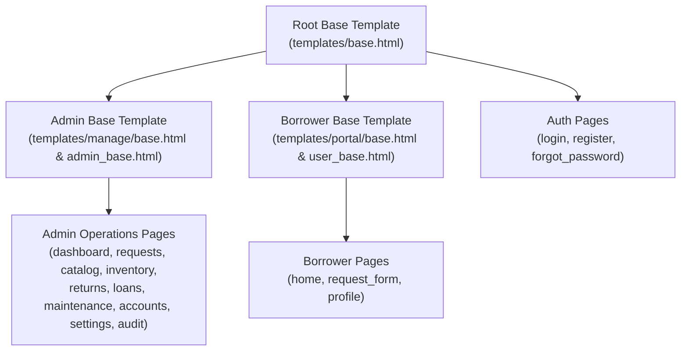

# CEBIS System Enhancement & Architectural Change Report

**Project:** Campus Equipment Borrowing and Inventory System (CEBIS)  
**Branch:** `feature/ui-architecture-redesign`  
**Date:** October 17, 2026  
**Status:** Completed & Verified

---

## Executive Summary

This report provides a detailed breakdown of all user interface enhancements, architectural refactorings, security improvements, and feature additions implemented across the CEBIS platform. The project has been brought into full alignment with the IT 401W project specifications, strictly excluding `django.contrib.admin`, establishing role-isolated base templates and reusable components, ensuring database concurrency invariants, and modernizing both the Borrower and Administrator portals.

---

## 1. Authentication & Security Redesign

### Split-Screen Visual Layout
- **Visual Design:** Replaced the legacy single-column auth forms with a modern 50/50 split-screen layout across [login.html](file:///s:/PythonProject/CampusEquipmentBorrowingSystem/templates/registration/login.html), [register.html](file:///s:/PythonProject/CampusEquipmentBorrowingSystem/templates/registration/register.html), and [forgot_password.html](file:///s:/PythonProject/CampusEquipmentBorrowingSystem/templates/registration/forgot_password.html).
- **Branding Panel:** The left hero side features the institution background image (`campus-background.png`), dark gradient overlay, CEBIS brand logo, and system value propositions.
- **Form Card:** The right side features a clean, elevated form card with a subtle gray backdrop, clear typography, and input focus rings.
- **Password Visibility Toggles:** Integrated toggle eye buttons (`.auth-eye-btn`) without background boxes, styled in subtle gray to cleanly reveal or mask password inputs.

### Forgot Password Flow & Validation
- **Multi-Step Verification Flow:** Users can identify their account using either their **username or registered email**.
- **Password Complexity Validation:** Uses Django’s `validate_password` engine to enforce security rules (minimum length, non-numeric, complexity) and verifies password confirmation matching before saving.
- **Audit Tracking:** Password resets and authentication actions log audit records with actor timestamps.

---

## 2. Basic User (Borrower) Portal Redesign

### Modernized User Header & Navigation
- **Header Alignment:** Positioned the CEBIS logo on the far left and all navigational controls on the far right.
- **Borrower Profile Pill:** Integrated a user avatar bubble and name badge displaying the user's initials, full name, and role.
- **Active Navigation Highlights:** Provides clear active-route indicators for **Catalog & Loans**, **New Request**, and **Profile**.
- **Sign Out Integration:** Clean inline logout form with logout icon.

### Catalog & Loans Hub ([`portal/home.html`](file:///s:/PythonProject/CampusEquipmentBorrowingSystem/templates/portal/home.html))
- **Hero Banner & Stat Chips:** Greets the borrower by name and summarizes their active borrowing status (Active Loans, Pending Requests, Overdue Loans, Available Equipment).
- **Interactive Equipment Catalog:**
  - Real-time catalog search bar.
  - Category pill filters with item counts.
  - Equipment cards showcasing hardware images, category badges, descriptions, and live availability chips.
  - Direct "Request Equipment" action buttons on available items.
  - Privacy compliance: Borrower names, internal maintenance notes, and audit records remain strictly hidden.
- **Borrower Request & Loan History:**
  - Tabular display of active, pending, returned, and overdue requests.
  - Clear status pills with color coding.
  - Safe cancellation button for pending and unreleased approved requests.

### Multi-Item Request Form ([`portal/request_form.html`](file:///s:/PythonProject/CampusEquipmentBorrowingSystem/templates/portal/request_form.html))
- Configurable borrowing duration checks against system settings (default 7 days max, 3 units per item).
- Dynamic item selection slots with validation preventing zero or negative quantities.

---

## 3. Template & Software Architecture (MTV Refactoring)

Per the specification document requirement:
> *"Use one base template for each role and reusable components for navigation, forms, tables, and messages."*

### Base Template Hierarchy

1. **Root Base Template ([`templates/base.html`](file:///s:/PythonProject/CampusEquipmentBorrowingSystem/templates/base.html)):**
   - Pure HTML5 shell containing `<head>`, metadata, fonts, global CSS, modal dialog markup (`#action-modal`), and modal JavaScript.
   - Removed monolithic conditional checks; delegates structure via ``.
2. **Admin Base Template ([`templates/manage/base.html`](file:///s:/PythonProject/CampusEquipmentBorrowingSystem/templates/manage/base.html)):**
   - Enforces the `.admin-layout` grid, includes the admin sidebar component, renders the admin topbar, content area, and admin footer.
   - Aliased by [`templates/admin_base.html`](file:///s:/PythonProject/CampusEquipmentBorrowingSystem/templates/admin_base.html).
3. **Borrower Base Template ([`templates/portal/base.html`](file:///s:/PythonProject/CampusEquipmentBorrowingSystem/templates/portal/base.html)):**
   - Enforces the `.borrower-shell`, includes the user header navigation component, borrower wrap, and site footer.
   - Aliased by [`templates/user_base.html`](file:///s:/PythonProject/CampusEquipmentBorrowingSystem/templates/user_base.html).

### Reusable Components Directory ([`templates/components/`](file:///s:/PythonProject/CampusEquipmentBorrowingSystem/templates/components/))
- **[`admin_sidebar.html`](file:///s:/PythonProject/CampusEquipmentBorrowingSystem/templates/components/admin_sidebar.html):** Sidebar navigation with SVG line icons, active route indicators, and secure logout.
- **[`user_header.html`](file:///s:/PythonProject/CampusEquipmentBorrowingSystem/templates/components/user_header.html):** Top navigation bar for basic users with logo, portal links, avatar pill, and logout.
- **[`messages.html`](file:///s:/PythonProject/CampusEquipmentBorrowingSystem/templates/components/messages.html):** Standardized flash message renderer supporting info, success, warning, and error tags.
- **[`pagination.html`](file:///s:/PythonProject/CampusEquipmentBorrowingSystem/templates/components/pagination.html):** Reusable table pagination controls with previous/next buttons and page counters.
- **[`form_errors.html`](file:///s:/PythonProject/CampusEquipmentBorrowingSystem/templates/components/form_errors.html):** Reusable form non-field and field errors alert component.

---

## 4. Reports & Computed Query Aggregations

Per the specification document requirement:
> *"At least one report must combine related models and computed totals."*

- **Multi-Model Query Integration:** In [`inventory/views.py:loans`](file:///s:/PythonProject/CampusEquipmentBorrowingSystem/inventory/views.py#L337-L370), the reporting engine queries and joins `Loan`, `BorrowRequest`, `UnitAllocation`, and `EquipmentUnit` using `select_related` and `prefetch_related` to eliminate N+1 database queries.
- **Computed Totals Engine:** Calculates live summary metrics across the filtered date range:
  - **Total Loans:** Total count of loans matching criteria.
  - **Active Loans:** Count of currently open/unreturned loans.
  - **Overdue Loans:** Count of loans exceeding agreed due dates.
  - **Overdue Days Sum:** Cumulative overdue days accumulated.
  - **Units Borrowed:** Total count of physical equipment units allocated.
- **Live Metric Cards:** Embedded at the top of [`templates/manage/loans.html`](file:///s:/PythonProject/CampusEquipmentBorrowingSystem/templates/manage/loans.html#L36-L60) above the records table.
- **Export Engine:** One-click CSV export with date range filtering and asset code reconciliation.

---

## 5. Concurrency, Invariants & Business Logic

- **Service Layer Encapsulation ([`inventory/services.py`](file:///s:/PythonProject/CampusEquipmentBorrowingSystem/inventory/services.py)):**
  - Atomic database transactions using `@transaction.atomic`.
  - Row-level database locks using `select_for_update()` on `BorrowRequest`, `EquipmentUnit`, and `UnitAllocation`.
  - Guarantees that two administrators approving competing requests for the last available physical unit will never double-allocate the unit.
- **Maintenance State Invariants:**
  - Creating maintenance records for issued or reserved units is strictly blocked.
  - Damaged returns automatically flag units as `MAINTENANCE` and generate maintenance logs.
- **Account Control:**
  - Custom admin user management allows deactivating basic users without deleting their records, immediately preventing deactivated accounts from initiating new transactions.

---

## 6. Changed Files Summary

| File Path | Description of Changes |
| :--- | :--- |
| `templates/base.html` | Converted to root layout shell; removed monolithic `if/else` role branching. |
| `templates/manage/base.html` | Admin base template wrapping `.admin-layout` and admin components. |
| `templates/admin_base.html` | Explicit admin base template alias. |
| `templates/portal/base.html` | Borrower base template wrapping `.borrower-shell` and user header. |
| `templates/user_base.html` | Explicit user base template alias. |
| `templates/components/*.html` | New reusable components: `admin_sidebar`, `user_header`, `messages`, `pagination`, `form_errors`. |
| `templates/manage/loans.html` | Added live computed total cards; converted pagination to component. |
| `templates/manage/accounts.html` | Converted pagination to reusable component. |
| `templates/manage/audit.html` | Converted pagination to reusable component. |
| `templates/manage/account_history.html` | Converted pagination to reusable component. |
| `templates/registration/*.html` | Redesigned 50/50 split-screen layout for login, register, forgot password. |
| `inventory/views.py` | Added report aggregations, prefetch optimizations, and forgot password view. |
| `inventory/forms.py` | Added forgot password form and password validation logic. |
| `inventory/services.py` | Atomic concurrency services (`decide_request`, `issue_request`, `return_unit`). |
| `static/css/site.css` | Comprehensive styling overhaul matching design specs across admin and user portals. |
