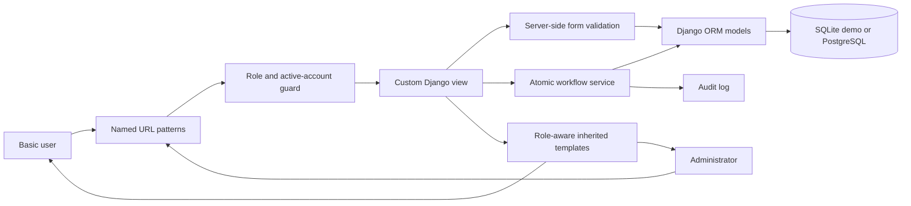
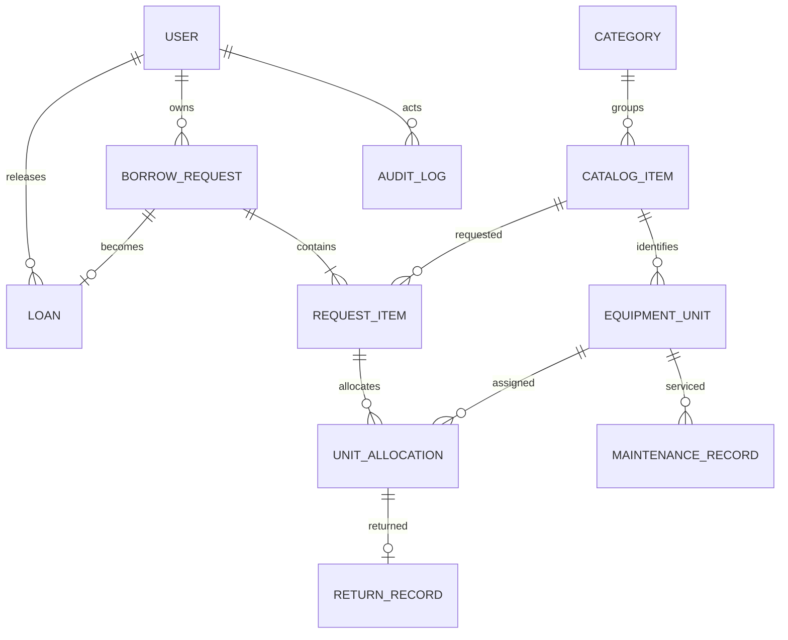
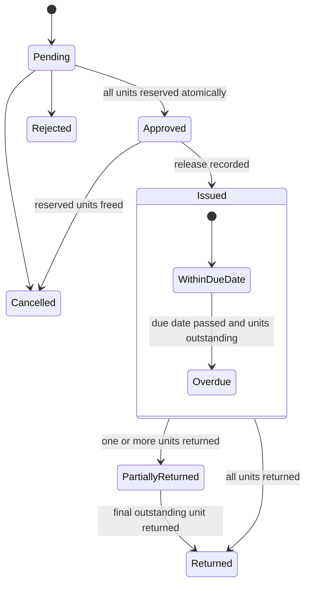

# System diagrams

## MTV application architecture

## Core entity relationships

## Request and equipment lifecycle

Overdue is a computed label and does not replace the request workflow status.

